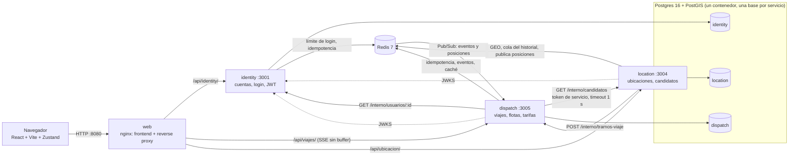

# app-viajes — Grupo 7 · Variante G (flotas y zonas)

Plataforma de viajes con microservicios. El pasajero pide un viaje; dispatch se lo ofrece a los choferes cercanos de las flotas que operan en la zona del origen; exactamente uno lo gana, y el viaje se sigue en tiempo real hasta el cobro.

- **Monorepo** con npm workspaces: tres servicios independientes (cada uno con su base, su imagen y su contenedor) que comparten repo, lockfile y CI.
- **Variante G:** flotas con un límite de choferes activos, zonas operativas en PostGIS y un reporte de viajes y facturación por flota.
- Plan completo: [PLAN.md](PLAN.md). Decisiones: [docs/adr](docs/adr). Guion de la demo: [docs/demo.md](docs/demo.md).

## Arquitectura en una vista



| Contenedor | Qué hace |
|---|---|
| `web` (nginx) | Único punto de entrada. Sirve el frontend y reenvía `/api/identity/`, `/api/viajes/` y `/api/ubicacion/`. No publica `/interno/*`, `/metrics` ni `/ready` |
| `identity` | Registro, login, JWT RS256 con JWKS, refresh con rotación, logout, límite de intentos de login |
| `dispatch` | Solicitudes, ofertas, asignación única, estados del viaje, historial, panel del operador, tiempo real (SSE), flotas y zonas, tarifas y cobro simulado |
| `location` | Ubicación de los choferes, búsqueda de candidatos (ingenua en Postgres u optimizada con Redis GEO), historial con retención, posición en vivo por Pub/Sub |
| `postgres` | `postgis/postgis:16-3.4`, con una base y un usuario por servicio: ningún servicio lee las tablas de otro |
| `redis` | Cerrojo de idempotencia, límite de login, Pub/Sub de eventos y posiciones, Redis GEO y caché de tarifas |

Detalle de los límites, la comunicación, el despliegue y la observabilidad: [docs/arquitectura.md](docs/arquitectura.md).

### Dónde está cada problema central

| Problema | Cómo se resuelve | Dónde |
|---|---|---|
| **6.3** Asignación única | `FOR UPDATE` de la solicitud y reserva única del chofer (`driver_active_assignment`). Test de 50 aceptaciones simultáneas: gana 1 | [ADR 0004](docs/adr/0004-asignacion-unica.md), `services/dispatch/tests/concurrencia/` |
| **6.6** Tarea pesada (500 choferes) | location aparte, en dos versiones: ingenua (un `INSERT` por ping) y optimizada (Redis GEO, historial en cola y escritura en lotes). Medidas con k6 | [ADR 0005](docs/adr/0005-tarea-pesada.md), [docs/mediciones.md](docs/mediciones.md) |
| **G** Límite de choferes activos por flota | `UPDATE … WHERE active_count < max_active` más un `CHECK`. Test de 50 activaciones con límite 10: quedan 10 | [docs/flotas.md](docs/flotas.md#la-carrera-g) |
| Reintentos sin doble efecto | `Idempotency-Key` obligatoria: cerrojo en Redis y registro en la misma transacción que el efecto | [ADR 0010](docs/adr/0010-idempotencia.md) |
| Tiempo real | Outbox → relay → Redis Pub/Sub → SSE, con reconexión por `Last-Event-ID` | [ADR 0007](docs/adr/0007-tiempo-real-sse.md), [docs/eventos.md](docs/eventos.md) |

## Tecnologías y para qué se usan

| Tecnología | Versión | Para qué |
|---|---|---|
| **Node.js** | 22 | Runtime de los tres servicios y de los scripts (`engines: >=22`) |
| **TypeScript** | 5.9 | Todo el backend y el frontend, en modo estricto y con módulos ES ([ADR 0001](docs/adr/0001-typescript-esm.md)) |
| **Express** | 5.3 | Servidor HTTP de cada servicio |
| **Zod** | 4.6 | Esquemas de `packages/contracts`: validación de cuerpo, query, parámetros y encabezados (lista blanca con `strictObject`), y de la configuración al arrancar |
| **Prisma** (`@prisma/client` + `@prisma/adapter-pg`) | 7.10 | Acceso a Postgres y migraciones de cada servicio. Los locks (`FOR UPDATE`, `SKIP LOCKED`) y PostGIS van en SQL |
| **PostgreSQL + PostGIS** | 16 + 3.4 | Una base por servicio. PostGIS guarda las zonas operativas (`geometry(Polygon, 4326)`) y resuelve la zona del origen |
| **Redis** (cliente `ioredis`) | 7 (ioredis 6) | Cerrojo de la `Idempotency-Key`, límite de intentos de login, Pub/Sub de eventos y posiciones, Redis GEO y la cola del historial (location optimizada), caché de tarifas |
| **jose** | 6.2 | Emisión (identity) y verificación (dispatch, location) de JWT RS256; las claves públicas por JWKS |
| **argon2** | 0.45 | Hash de contraseñas (argon2id) en identity |
| **helmet** | 8.3 | Encabezados de seguridad de la API, con una CSP `default-src 'none'` |
| **pino** | 10.4 | Logs JSON, con el `requestId` de cada pedido |
| **@prometheus-io/client** | 0.16 | `GET /metrics` en los tres servicios: lag del event loop, memoria, duración por ruta y métricas de negocio |
| **nginx** (`nginx-unprivileged`) | 1.27 | Contenedor `web`: frontend, reverse proxy, CSP de la página, SSE sin buffer |
| **React** | 19.3 | Frontend (`apps/web`) |
| **Vite** | 8.3 | Build y servidor de desarrollo del frontend |
| **Zustand** | 5.1 | Estado del frontend: sesión y un store por pantalla |
| **React Router** | 7.18 | Rutas del frontend, protegidas por rol |
| **Leaflet** + OpenStreetMap | 1.9.4 | El mapa del pasajero |
| **Vitest** + **supertest** | 4.1 / 7.3 | Tests de dominio, integración, concurrencia y seguridad, contra Postgres y Redis reales |
| **Playwright** | 1.64 | Cinco flujos end to end contra el sistema en Docker Compose (`e2e/`) |
| **k6** (`grafana/k6`) | 1.8.2 | Simulador de 500 choferes, solicitudes bajo carga, estrés y la carrera de 6.3 (`carga/`) |
| **ESLint** + `typescript-eslint` | 10 / 8.72 | Lint, incluida la regla que impide que el dominio importe infraestructura |
| **tsx** | 4.23 | `npm run dev`: los servicios con recarga, sobre el código fuente |
| **Docker** + **Docker Compose** | — | Una imagen por servicio (`Dockerfile` genérico con `SERVICE`) y otra para `web`; el sistema entero con un `docker compose up` |
| **GitHub Actions** | — | CI con tres jobs: `verificar`, `e2e` y `sast` ([docs/ci.md](docs/ci.md)) |
| **Semgrep** | 1.182.1 | SAST en el CI, con reglas de JavaScript, TypeScript, Node, OWASP y secretos |
| `npm audit` | — | Dependencias con vulnerabilidades altas, en el CI |

Las versiones exactas están en los `package.json` y en `package-lock.json`.

## Requisitos

Node 22 o superior y Docker con Compose. Los comandos son los mismos en Windows (PowerShell) y en Linux, salvo los de `carga/`, que son de PowerShell.

## Levantar el sistema

```bash
npm install
npm run setup         # .env, clave RS256, Postgres y Redis, bases que falten, migraciones y usuarios de prueba
npm run dev           # identity (3001), location (3004) y dispatch (3005) en una terminal, con recarga
```

- **`npm run setup`** se puede correr las veces que haga falta: cada paso es idempotente y ninguno borra datos.
  - Si no hay `.env`, lo copia de `.env.example`. Si hay uno viejo, le **agrega** las variables nuevas de `.env.example` y avisa cuáles, sin tocar las que ya tenía.
  - Genera la clave RS256 de identity si falta.
  - Levanta Postgres y Redis con Docker Compose y crea las bases que falten (las de desarrollo y las `*_test`). El script de init de Postgres solo corre con el volumen vacío; un volumen anterior a un servicio queda sin su base. No hace falta `docker compose down -v`, que borra todos los datos.
  - Genera el cliente de Prisma, migra las tres bases de desarrollo y carga los usuarios de prueba (`npm run seed`).
  - Con `npm run setup -- --sin-docker` no toca Docker: Postgres y Redis los provee otro, por ejemplo el CI.
- **`npm run dev`** levanta los tres servicios en una sola terminal, con el `.env` cargado. Cada línea va con el nombre del servicio adelante. Ctrl+C los apaga ordenados. Si uno se cae, los otros siguen y tsx lo reinicia cuando guardás un archivo; el lanzador avisa cuando deja de responder y cuando vuelve. Si un puerto está ocupado, lo dice antes de arrancar.
- **`npm start`** hace lo mismo con el código compilado (`npm run build` antes). Acá, si uno se cae, apaga los otros dos y sale con error.
- **El frontend en desarrollo:** `npm run dev:web` (http://localhost:5173, con el mismo enrutamiento que nginx).
- **En contenedores**, en lugar de `npm run dev` o `npm start`:

  ```bash
  docker compose up -d --build   # postgres, redis, identity, location, dispatch y web
  npm run demo:flotas            # zonas CABA y Norte, las dos flotas y el chofer del seed activo
  ```

  - El punto de entrada es el contenedor `web` (nginx): http://localhost:8080 (`WEB_PUERTO`), con la API en `/api/identity/`, `/api/viajes/` y `/api/ubicacion/`. Usan las mismas bases ya migradas y la clave del `.env`.
  - **Sin `npm run demo:flotas` no hay zonas:** toda solicitud da 422 `ORIGEN_FUERA_DE_ZONA`. El script es idempotente.
  - `npm run web:probar` revisa la CSP, los encabezados, que lo interno no se publique y que el SSE pase sin buffer ([docs/web.md](docs/web.md#probarlo)).
- **Un solo servicio**, con el `.env` cargado y su puerto fijo: `npm run local -- identity` (o `location`, `dispatch`; solo en PowerShell). Más detalles en [docs/identity.md](docs/identity.md) y [docs/location.md](docs/location.md).

`DISPATCH_LOG_SQL=1` muestra cada query en el log, incluido el `SELECT ... FOR UPDATE`.

**Métricas:** los tres servicios publican `GET /metrics` en formato de Prometheus, con `Authorization: Bearer <METRICAS_TOKEN>` (del `.env`). Incluye el lag del event loop, la memoria y la duración por ruta; dispatch suma solicitudes, asignaciones, ofertas vencidas y el tiempo hasta la asignación. `/metrics` no se publica por nginx: se lee en el puerto de cada servicio.

## Usuarios de prueba

Los carga `npm run seed` (lo corre `npm run setup`), desde `services/identity/src/infra/db/semilla.ts`. Todos tienen la misma contraseña: **`IDENTITY_SEED_CONTRASENA` del `.env`**, que en `.env.example` es `solo-desarrollo-viajes-2026`. Solo para desarrollo: el seed no corre con `NODE_ENV=production`.

| Email | Rol | Id | Flota |
|---|---|---|---|
| `pasajero@viajes.test` | `pasajero` | `00000000-0000-4000-8000-000000000001` | — |
| `chofer@viajes.test` | `chofer` | `00000000-0000-4000-8000-000000000002` | Flota Demo, habilitado y activo (lo deja así `npm run demo:flotas`) |
| `operador@viajes.test` | `operador` | `00000000-0000-4000-8000-000000000003` | — |
| `admin@viajes.test` | `admin` | `00000000-0000-4000-8000-000000000004` | — |
| `admin.flota@viajes.test` | `admin_flota` | `00000000-0000-4000-8000-000000000005` | Flota Demo (`…0000000000f1`), opera en la zona CABA |
| `admin.flota2@viajes.test` | `admin_flota` | `00000000-0000-4000-8000-000000000006` | Flota Norte (`…0000000000f2`), opera en la zona Norte. Sirve para probar el aislamiento entre flotas |

- **Las flotas y las zonas** no las crea el seed (viven en dispatch): las crea `npm run demo:flotas` por la API. Si una flota no existe, la crea con límite 5; si existe, no toca su nombre ni su límite.
- **Por el registro público** (`POST /api/identity/registro`) solo se crean pasajeros y choferes. `operador`, `admin` y `admin_flota` salen solo del seed.
- **Los flujos de Playwright** registran choferes de un solo uso (`e2e-chofer-<sufijo>@viajes.test`) con la misma contraseña.

## Roles y permisos

Hay cinco roles (`Rol` en `packages/contracts/src/identity.ts`). El rol va en el JWT, que firma identity. Las rutas, con el prefijo de nginx:

| Ruta | `pasajero` | `chofer` | `operador` | `admin` | `admin_flota` |
|---|---|---|---|---|---|
| **identity** (`/api/identity`): `POST /registro`, `/login`, `/refresh`, `/logout`, `GET /.well-known/jwks.json` | públicas | públicas | públicas | públicas | públicas |
| `GET /api/viajes/tarifas/estimacion` | sí | — | sí | sí | — |
| `POST /api/viajes/solicitudes` (pedir un viaje) | sí | — | — | — | — |
| `GET /api/viajes/solicitudes/:id` | las propias | las asignadas a él | todas | todas | 404 |
| `POST /api/viajes/solicitudes/:id/cancelar` | la propia, hasta `EN_CAMINO` | la asignada, en `ASIGNADO` o `EN_CAMINO` | cualquier activa, con motivo | cualquier activa, con motivo | — |
| `POST /api/viajes/ofertas/:id/aceptar` | — | sus ofertas | — | — | — |
| `POST /api/viajes/solicitudes/:id/en-camino`, `/iniciar`, `/finalizar` | — | el chofer asignado | — | — | — |
| `POST /api/viajes/solicitudes/:id/cobrar` | el propio | — | todos | todos | — |
| `GET /api/viajes/historial` | el propio | el propio | — | — | — |
| `GET /api/viajes/eventos` (SSE) | los propios | los propios | — | — | — |
| `GET /api/viajes/chofer/estado`, `PUT /api/viajes/chofer/disponibilidad` | — | el propio | — | — | — |
| `GET /api/viajes/panel/viajes` (búsqueda con `q`) | — | — | sí | sí | — |
| `GET` y `PUT /api/viajes/admin/tarifas` | — | — | — | sí | — |
| `PUT /api/viajes/admin/flotas/:id`, `PUT /admin/flotas/:id/zonas`, `PUT /admin/zonas/:id`, `GET /admin/zonas` | — | — | — | sí | — |
| `POST /api/viajes/admin/choferes/:id/habilitar`, `/deshabilitar` | — | — | — | sí | — |
| `GET /api/viajes/flota`, `/flota/reporte`, `/flota/choferes`, `/flota/choferes/:id` | — | — | — | — | su flota |
| `POST /api/viajes/flota/choferes`, `/flota/choferes/:id/activar`, `/desactivar` | — | — | — | — | su flota |
| `POST /api/ubicacion/ubicaciones` | — | la propia | — | — | — |
| `POST /api/ubicacion/ubicaciones/pasajero` | la propia | — | — | — | — |
| **Pantalla** | `/pasajero`, `/pasajero/historial` | `/chofer` | `/operador` | `/operador` (lo demás, por la API) | `/flota` |

«—» es **403 `ROL_NO_PERMITIDO`**. Sin token o con uno vencido, **401 `NO_AUTENTICADO`**. Las rutas `/interno/*` no aceptan el JWT de ningún rol: solo el token de servicio, y nginx no las publica.

**Cómo se aplica.** Dos capas:
1. **El rol, en la ruta:** `requerirRol(...)` de `packages/platform` (`services/*/src/infra/http/*.ts`). El frontend también separa las pantallas por rol, pero la autorización de verdad es la de la API.
2. **El recurso, en el caso de uso:** lo ajeno responde **404**, el mismo error que lo inexistente, así no se revela que existe.

| Recurso | Regla | Lo ajeno |
|---|---|---|
| Quién hace el pedido | Sale siempre del `sub` del token, nunca del cuerpo. Los esquemas son `strictObject`: un `choferId`, `pasajeroId` o `fleetId` en el cuerpo da 400 `VALIDACION` | — |
| Viajes del pasajero | Ve, cancela y cobra solo sus solicitudes (`obtener-solicitud.ts`, `cancelar-solicitud.ts`, `cobrar.ts`). El historial sale del token | 404 `SOLICITUD_NO_ENCONTRADA` / `COBRO_NO_ENCONTRADO` |
| Viajes del chofer | Acepta solo sus ofertas; avanza y cancela solo el viaje que tiene asignado (`aceptar-oferta.ts`, `avanzar-viaje.ts`) | 404 `OFERTA_NO_ENCONTRADA` / `SOLICITUD_NO_ENCONTRADA` |
| Operador y admin | Ven todas las solicitudes y cancelan cualquier activa, siempre con motivo (sin motivo, 422 `MOTIVO_REQUERIDO`). El admin cancela como operador: queda `CANCELADO_OPERADOR` | — |
| Flota del `admin_flota` | La flota sale del `fleetId` del token. Cada operación sobre un chofer exige que sea de esa flota (`dominio/casos-uso/flotas.ts`) | 404 `CHOFER_NO_ENCONTRADO`. Sin `fleetId`: 403 `FLOTA_NO_ASIGNADA` |
| Eventos del viaje (SSE) | Cada evento se publica solo en el canal de su pasajero y de su chofer; la reposición filtra igual | No llegan |
| Posición en vivo | La del chofer la ve solo el pasajero de su viaje activo, y la del pasajero solo su chofer, mientras el viaje está `ASIGNADO`, `EN_CAMINO` o `EN_CURSO` (`infra/tiempo-real/seguimiento.ts`). location toma el id del token: nadie informa la posición de otro | No llega; un `choferId` en el cuerpo da 400 |

**Límites de tasa** (429, con encabezados `RateLimit-*` y `Retry-After`): el login, por email y por IP (`IDENTITY_LOGIN_MAX_POR_EMAIL`, `IDENTITY_LOGIN_MAX_POR_IP`); `POST /solicitudes`, por pasajero (`LIMITE_SOLICITUDES_POR_MINUTO`, 10 por minuto); los pings de `/ubicaciones`, por usuario (`LIMITE_UBICACIONES_POR_MINUTO`, 120 por minuto); y como mucho 3 streams SSE abiertos por usuario.

Detalle de las reglas de cada recurso: [docs/flotas.md](docs/flotas.md#alcance-por-flota), [docs/eventos.md](docs/eventos.md#posición-en-vivo), [docs/location.md](docs/location.md).

## Tests

```bash
npm run lint
npm run typecheck
npm test          # dominio en memoria + integración, concurrencia y seguridad contra Postgres y Redis
```

- `npm test` usa las bases `*_test` que crea `npm run setup`.
- Solo los tests de dominio, sin Docker: `npm run test:dominio -w @viajes/dispatch` (o `-w @viajes/identity`, `-w @viajes/location`).
- Un archivo: `npm test -w @viajes/dispatch -- tests/concurrencia/asignacion-unica.test.ts`.
- Cada test de concurrencia está comprobado: falla si se saca la protección que prueba (ver los ADR y [docs/flotas.md](docs/flotas.md#cómo-se-sabe-que-el-test-detecta-la-falta-de-la-protección)).

**End to end** (Playwright, los cinco flujos, contra el sistema en Docker Compose):

```bash
npx -w @viajes/e2e playwright install chromium   # la primera vez (en Linux, con --with-deps)
npm run e2e:levantar   # Compose con la configuración del e2e y la demo de flotas
npm run e2e            # el reporte: npm run reporte -w @viajes/e2e
```

**SAST** (Semgrep) y los jobs del CI: [docs/ci.md](docs/ci.md).

**Carga con k6** (PowerShell, en un entorno de Compose aislado, `viajes-carga`):

```powershell
node carga/preparar.mjs                                                                                   # secretos y 500 tokens de chofer
powershell -NoProfile -ExecutionPolicy Bypass -File carga/medir.ps1 -Estrategia optimizada -Corrida 1     # 500 choferes, 250 pings/s
powershell -NoProfile -ExecutionPolicy Bypass -File carga/medir.ps1 -Estrategia optimizada -Corrida 1 -Solicitudes   # más viajes en paralelo
powershell -NoProfile -ExecutionPolicy Bypass -File carga/estres.ps1 -Corrida 1                           # rampa de estrés
powershell -NoProfile -ExecutionPolicy Bypass -File carga/carrera.ps1 -Corrida 1                          # 50 aceptaciones a la vez (6.3)
node carga/resumir.mjs docs/mediciones/<fecha>                                                            # tablas del informe
```

Prueba corta de `medir.ps1`: `-Medicion 30 -Calentamiento 5`. Detalle: [carga/README.md](carga/README.md). Resultados e hipótesis: [docs/mediciones.md](docs/mediciones.md).

## Estructura

```
packages/kernel      lo único que el dominio puede importar (ErrorDeDominio, Reloj, GeneradorId)
packages/contracts   esquemas Zod de requests, respuestas y eventos (lista blanca con strictObject)
packages/platform    infraestructura HTTP compartida: app, logs, errores, JWT, idempotencia, métricas, cliente interno
services/<servicio>
  src/dominio/       entidades, casos de uso, puertos, errores — sin Express, Prisma ni Redis
  src/infra/         http, db (Prisma + SQL de locks), memoria, externos, tiempo real
  src/composicion.ts único lugar que elige adaptadores
  prisma/            schema y migraciones (una base por servicio)
  tests/             dominio, integracion, concurrencia, seguridad
apps/web             frontend React (lo compila y lo sirve el contenedor web)
infra/web            nginx: configuración y Dockerfile del contenedor web
infra/postgres/init  crea una base y un usuario por servicio
e2e/                 Playwright
carga/               k6 y el entorno de carga aislado
scripts/             setup, dev/start, seed de la demo de flotas, prueba de nginx
ataque/              scripts de carreras e idempotencia para el ataque cruzado
docs/                documentación, ADR y mediciones
```

## Documentación

**Para empezar**
- [docs/arquitectura.md](docs/arquitectura.md): servicios y sus límites, comunicación entre servicios, nginx, despliegue con Compose, observabilidad, y por qué es un monorepo de microservicios y no un monolito.
- [docs/modelo.md](docs/modelo.md): el modelo de datos y la máquina de estados del viaje.
- [docs/api.md](docs/api.md): la API completa, con los errores de cada ruta.
- [docs/demo.md](docs/demo.md): el guion de la demo, paso a paso. La colección de pedidos: [docs/demo.http](docs/demo.http).

**Por servicio y módulo**
- [docs/identity.md](docs/identity.md): contrato de identity, token, contraseñas, límite de login, usuarios de prueba y prueba manual.
- [docs/location.md](docs/location.md): contrato de location, versiones ingenua y optimizada, retención del historial, posición en vivo y contrato con dispatch.
- [docs/flotas.md](docs/flotas.md): flotas, la carrera G, zonas en PostGIS, filtro de candidatos, revalidación al aceptar y reporte.
- [docs/tarifas.md](docs/tarifas.md): tarifa en centavos enteros, estimación, configuración por el admin, tarifa final y cobro.
- [docs/eventos.md](docs/eventos.md): outbox, relay, SSE, reconexión con `Last-Event-ID`, posición en vivo y catálogo de eventos.
- [docs/web.md](docs/web.md): el contenedor nginx, la CSP y las pantallas de cada rol.
- [docs/seguridad.md](docs/seguridad.md): la seguridad transversal de `packages/platform`, común a los tres servicios.

**Calidad y mediciones**
- [docs/ci.md](docs/ci.md): los jobs del CI, Playwright y Semgrep.
- [docs/mediciones.md](docs/mediciones.md): informe de mediciones (6.6, 6.3 y solicitudes bajo carga y estrés), con las corridas en [docs/mediciones/](docs/mediciones). Cómo reproducirlas: [carga/README.md](carga/README.md).
- [docs/ataque.md](docs/ataque.md): guía y bitácora del ataque cruzado. Los scripts de carreras e idempotencia, en [ataque/](ataque/README.md).

**Decisiones de arquitectura** ([docs/adr](docs/adr))
- [0001](docs/adr/0001-typescript-esm.md): TypeScript estricto con módulos ES.
- [0004](docs/adr/0004-asignacion-unica.md): asignación única con `FOR UPDATE` y restricción única del chofer.
- [0005](docs/adr/0005-tarea-pesada.md): la tarea pesada, con Redis GEO e historial en cola.
- [0006](docs/adr/0006-tres-microservicios.md): tres microservicios.
- [0007](docs/adr/0007-tiempo-real-sse.md): tiempo real con SSE, outbox y Redis Pub/Sub.
- [0010](docs/adr/0010-idempotencia.md): `Idempotency-Key` obligatoria.
- [0011](docs/adr/0011-vencimiento-ofertas.md): vencimiento de ofertas con el reloj del servidor y barrido periódico.
- [0012](docs/adr/0012-inventario-carreras.md): inventario de carreras y qué garantiza cada invariante.

**Del equipo**
- [PLAN.md](PLAN.md): plan del proyecto, estado de cada requisito y de la rúbrica.
- [docs/reparto.md](docs/reparto.md): quién hace qué (Ivan, Agos, Maxi), dependencias y reglas de colaboración.
- [docs/consultas-catedra.md](docs/consultas-catedra.md): consultas a la cátedra y respuestas.
- [docs/repaso-problemas-centrales.html](docs/repaso-problemas-centrales.html): repaso de 6.3, 6.6 y la variante G con diagramas de tiempos (abrir en el navegador).
