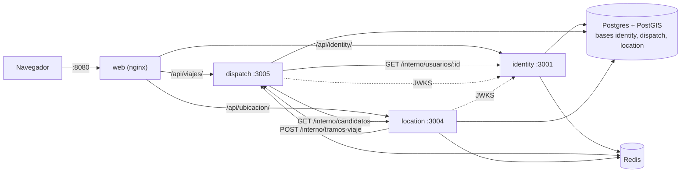
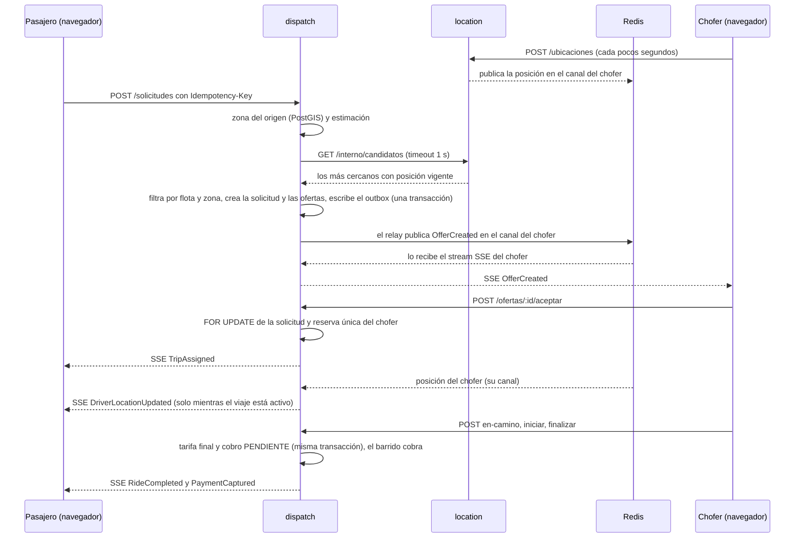

# Arquitectura

Tres microservicios (`identity`, `dispatch` y `location`) detrás de un nginx, con un Postgres (una base por servicio) y un Redis. Todo en un monorepo y levantado con Docker Compose. Por qué estos tres y no otros: [ADR 0006](adr/0006-tres-microservicios.md) y la sección 2 del [plan](../PLAN.md).



## Los servicios y sus límites

| Servicio | Qué resuelve | Datos propios | Puerto |
|---|---|---|---|
| **identity** | Registro (solo `pasajero` y `chofer`), login, JWT RS256, JWKS, refresh con rotación y detección de reuso, logout, límite de intentos de login | Usuarios (con su rol y, el `admin_flota`, su `fleetId`) y sesiones de refresh | 3001 |
| **dispatch** | **Viajes:** solicitud, ofertas con vencimiento, asignación única, estados, historial, panel del operador, tiempo real (SSE). **Flotas:** choferes con vehículo, habilitación, límite de activos, zonas en PostGIS, reporte. **Tarifas:** estimación, configuración por el admin, tarifa final y cobro simulado | Solicitudes, ofertas, asignación activa de cada chofer, outbox, flotas, choferes, zonas, tarifas, cobros, claves de idempotencia | 3005 |
| **location** | Ubicación de los choferes, búsqueda de candidatos cercanos, historial de pings con retención, publicación de las posiciones en vivo | Posición vigente e historial de cada chofer | 3004 |

**Por qué flotas y tarifas van dentro de dispatch:** comparten transacción con el viaje. El filtro de candidatos por flota y zona, la revalidación al aceptar, la liberación del chofer al terminar y la tarifa final se resuelven en una sola base, sin transacciones distribuidas.

**Por qué location va aparte:** es la tarea pesada (500 choferes, un ping cada 2 s). En su propio proceso no le saca event loop a la asignación de viajes. Se midió: con 250 pings/s contra location, el lag p99 de dispatch quedó en 5 ms o menos ([docs/mediciones.md](mediciones.md#conclusión-de-cada-hipótesis), HS4).

**Qué no sabe cada uno:**
- location no sabe de viajes ni de flotas: devuelve los choferes más cercanos con posición vigente, y dispatch los filtra en su base (habilitado, activo, disponible, sin viaje activo, de una flota con la zona del origen).
- dispatch no guarda cuentas: el `choferId` de una flota se verifica en identity con `GET /interno/usuarios/:id`.
- identity guarda el `fleetId` del `admin_flota` sin clave foránea (la flota vive en dispatch) y lo pone en el token. dispatch valida que la flota exista cuando se usa.

### Qué hace que esto sea microservicios

1. **Proceso separado:** cada servicio tiene su contenedor, su puerto y su `/health`. Si location se cae, identity sigue respondiendo.
2. **Datos propios:** cada servicio tiene su base y su usuario de Postgres. `infra/postgres/init` hace `REVOKE ALL ... FROM PUBLIC`: dispatch no puede leer la base de identity aunque quiera.
3. **Comunicación solo por contratos:** HTTP interno con timeout o Redis Pub/Sub, con los esquemas en `packages/contracts`. Ningún servicio importa código de dominio de otro.
4. **Despliegue independiente:** cada servicio tiene su imagen y su contenedor, y se reinicia sin tocar a los demás.

Si se rompe cualquiera de las cuatro, el resultado es un **monolito distribuido**: por ejemplo, si location hiciera `SELECT` en la base de dispatch.

### Capas dentro de cada servicio

Arquitectura hexagonal, con la misma forma en los tres:

| Carpeta | Qué va | Qué no puede importar |
|---|---|---|
| `src/dominio/` | Entidades, casos de uso, puertos y errores | Express, Prisma, Redis, `@viajes/platform`, `infra/`. Lo impide la regla `no-restricted-imports` de ESLint: `npm run lint` falla |
| `src/infra/` | Adaptadores: HTTP, Prisma y SQL, Redis, memoria, servicios externos | — |
| `src/composicion.ts` | El único lugar que elige los adaptadores según la configuración | — |

Cada puerto tiene al menos dos adaptadores: por ejemplo, candidatos desde location o una lista fija (`DISPATCH_BUSCADOR`), ubicaciones ingenua u optimizada (`UBICACION_ESTRATEGIA`), mapas y pagos simulados con timeout, y bus de eventos en Redis o en memoria.

## Comunicación entre servicios

| De → a | Mecanismo | Para qué | Si falla |
|---|---|---|---|
| dispatch, location → identity | **JWKS** (`/.well-known/jwks.json`), con las claves en caché (`createRemoteJWKSet` de jose) | Verificar el JWT de cada pedido sin llamar a identity | Siguen verificando con las claves en caché; cuando vencen, 401 hasta que identity vuelva |
| dispatch → location | **HTTP interno** `GET /interno/candidatos`, con token de servicio y timeout (`LOCATION_TIMEOUT_MS`, 1 s) | Los choferes más cercanos al origen, ordenados por distancia | La solicitud responde **503 `UBICACION_NO_DISPONIBLE`** y no se crea (falla cerrado). En el barrido, la solicitud sigue `BUSCANDO` y se reintenta |
| dispatch → identity | **HTTP interno** `GET /interno/usuarios/:id`, con token de servicio y timeout (`IDENTITY_TIMEOUT_MS`, 1 s) | Que el chofer que se da de alta en una flota sea una cuenta real de chofer | 503 `IDENTITY_NO_DISPONIBLE`: no se da de alta a nadie sin comprobarlo |
| location → dispatch | **HTTP interno** `POST /interno/tramos-viaje`, con token de servicio y timeout (`DISPATCH_TIMEOUT_MS`, 1 s) | Saber qué pings fueron de un viaje, para la retención (30 días los de viaje, 24 h los demás) | Conserva el lote y reintenta en la próxima pasada |
| location → dispatch | **Redis Pub/Sub**, un canal por persona: `<prefijo>posicion:<choferId>` y `<prefijo>posicion-pasajero:<pasajeroId>` | Posición en vivo para el seguimiento | Se pierde la posición; los eventos del viaje siguen llegando |
| dispatch → navegador | **SSE** (`GET /eventos`), alimentado por el outbox y Redis Pub/Sub | Estados del viaje, ofertas, cobro y posición de la otra parte | El cliente reconecta con `Last-Event-ID` y relee el estado |

**Token de servicio.** Las rutas `/interno/*` piden el encabezado `X-Token-Servicio`, con un secreto distinto por destino: `LOCATION_TOKEN_SERVICIO`, `IDENTITY_TOKEN_SERVICIO` y `DISPATCH_TOKEN_SERVICIO`. Se compara su SHA-256 en tiempo constante. El JWT de un usuario no las abre, y nginx no las publica.

**Cliente interno** (`packages/platform/src/cliente-interno.ts`): `fetch` con **timeout siempre**, exige 2xx y **valida la respuesta con el esquema de `contracts`**. Cualquier falla (timeout, red, estado o cuerpo fuera de contrato) es un `ErrorServicioInterno`, y quien llama decide: 503 al cliente o reintentar en el barrido.

**Sin broker de mensajes.** Del plan original salió RabbitMQ: nadie lo exige y ningún código lo usa. Los eventos de dispatch se guardan en su tabla `outbox`, en la misma transacción que el cambio de estado.

### Un viaje, de punta a punta



Detalle del tiempo real: [docs/eventos.md](eventos.md) y [ADR 0007](adr/0007-tiempo-real-sse.md). De la asignación única: [ADR 0004](adr/0004-asignacion-unica.md). De la idempotencia: [ADR 0010](adr/0010-idempotencia.md).

### Qué guarda Redis

Un solo Redis para todos, separado por prefijos.

| Servicio | Qué guarda |
|---|---|
| identity | Contadores del límite de intentos de login (por email y por IP); el cerrojo de la `Idempotency-Key` del registro |
| dispatch | El cerrojo de la `Idempotency-Key` (`SET NX` mientras el pedido está en vuelo); un canal de Pub/Sub por usuario para los eventos (`dispatch:eventos:<usuarioId>`); las suscripciones a las posiciones; la caché de tarifas por versión; el contador del límite de tasa de `POST /solicitudes` |
| location | En la versión optimizada: posición vigente (HASH + GEO + ZSET para el vencimiento), la cola del historial (STREAM) y el contador del límite de tasa de los pings (en la ingenua, ese contador va en memoria). En las dos versiones: la publicación de las posiciones en vivo |

Si Redis no responde, lo que depende de él **falla cerrado**: el login (503 `LIMITE_NO_DISPONIBLE`), toda ruta con `Idempotency-Key` (503 `IDEMPOTENCIA_NO_DISPONIBLE`) y el stream SSE (503 `EVENTOS_NO_DISPONIBLE`). La excepción es el límite de tasa de solicitudes y pings (`limitarTasa` de `platform`): falla abierto, porque protege la capacidad y no un secreto.

### Tareas en segundo plano

| Servicio | Tarea | Cada cuánto |
|---|---|---|
| dispatch | Barrido de ofertas vencidas: marca `OfferExpired` y ofrece a la próxima tanda, o deja `SIN_CHOFERES` | `BARRIDO_INTERVALO_MS`, 2 s (las ofertas duran `OFERTA_TTL_SEGUNDOS`, 15 s) |
| dispatch | Cobro de los viajes completados con cobro `PENDIENTE` | Con el barrido, cada 2 s |
| dispatch | Relay del outbox a Redis Pub/Sub, con `FOR UPDATE SKIP LOCKED` | `RELAY_INTERVALO_MS`, 100 ms |
| dispatch, identity | Purga de las claves de idempotencia vencidas (24 h), por lotes | `IDEMPOTENCIA_PURGA_INTERVALO_MS`, 60 s |
| location | Escritura del historial en lotes (optimizada) | Continua, lotes de `LOCATION_HISTORIAL_LOTE` |
| location | Retención del historial | `LOCATION_HISTORIAL_RETENCION_INTERVALO_MS`, 5 min |

## nginx: el punto de entrada

El contenedor `web` (`infra/web/`) es el único que tiene que quedar publicado. Detalle: [docs/web.md](web.md).

```
navegador ──▶ web :8080 ─┬─ /                → el frontend (React, compilado en la imagen)
                         ├─ /api/identity/   → identity :3001
                         ├─ /api/viajes/     → dispatch :3005   (/api/viajes/eventos: SSE sin buffer)
                         └─ /api/ubicacion/  → location :3004
```

- **Lo interno no pasa:** `/interno/*`, `/metrics` y `/ready` responden 404 desde nginx, sin distinguir mayúsculas y contra la ruta ya normalizada (`%69nterno` o `//interno` tampoco pasan).
- **SSE:** `proxy_buffering off` y `proxy_read_timeout` de 60 s, mayor que el latido de 15 s de dispatch.
- **La IP del cliente:** nginx **reemplaza** `X-Forwarded-For`. Cada servicio cree en ese encabezado solo si viene de la IP fija de nginx (`CONFIAR_EN_PROXY` = `WEB_IP`). Así el límite de login por IP cuenta por cliente, y un `X-Forwarded-For` inventado no sirve.
- **CSP de la página:** todo del mismo origen, sin scripts ni estilos en línea. Lo único de afuera son las teselas de OpenStreetMap, como imágenes.
- **`X-Request-Id`:** nginx manda el suyo y `platform` lo usa como `requestId`: el mismo pedido se sigue en el log de nginx y en el del servicio.
- **Mismo origen:** el frontend y la API están en `:8080`, así que no hace falta CORS.

## Despliegue con Docker Compose

`docker-compose.yml` levanta seis contenedores: `postgres`, `redis`, `identity`, `location`, `dispatch` y `web`.

| Contenedor | Imagen | Puerto del host |
|---|---|---|
| `postgres` | `postgis/postgis:16-3.4`, con `infra/postgres/init` (una base y un usuario por servicio) | `POSTGRES_PUERTO_HOST`, 5434 |
| `redis` | `redis:7-alpine` | 6379 |
| `identity`, `location`, `dispatch` | El `Dockerfile` de la raíz, genérico: `--build-arg SERVICE=<servicio>` | 3001, 3004, 3005 (solo para desarrollo) |
| `web` | `infra/web/Dockerfile`: compila el frontend con Vite y lo sirve con `nginxinc/nginx-unprivileged:1.27-alpine` | `WEB_PUERTO`, 8080 |

- **La imagen de cada servicio** se construye en dos etapas: compila `kernel`, `contracts`, `platform` y el servicio, y la final queda solo con las dependencias de producción, corre como el usuario `node` y tiene un `HEALTHCHECK` contra `/health`.
- **Orden de arranque:** los servicios esperan a que Postgres y Redis estén `healthy`. El healthcheck de Postgres va por TCP, para no dar `healthy` mientras corren los scripts de init.
- **Redes:** `web` y los tres servicios comparten la red `proxy` (`WEB_RED`, `10.250.77.0/28`), donde nginx tiene la IP fija `WEB_IP`. Postgres y Redis quedan en la red por defecto.
- **Configuración:** todo sale del `.env` (lo arma `npm run setup` desde `.env.example`). Cada servicio la valida con Zod al arrancar: si falta una variable obligatoria, no arranca y la nombra.
- **Secretos:** la clave RS256 de identity, los tres tokens de servicio y `METRICAS_TOKEN` van solo en el `.env`, que no se versiona.
- **Migraciones:** las corre `npm run setup` (`prisma migrate deploy` de cada servicio) contra las mismas bases que usan los contenedores.
- **Estrategia de location en el Compose:** `UBICACION_ESTRATEGIA` sale del `.env` (`ingenua` si falta; el `.env.example` trae `ingenua`). Para la demo con 500 choferes conviene `optimizada`, que es la que aguanta la carga ([mediciones.md](mediciones.md)).
- **Apagado ordenado:** con SIGTERM, cada servicio deja de aceptar conexiones, corta los streams SSE (el cliente reconecta), espera los pedidos en curso y los barridos, cierra sus conexiones y sale. Si tarda más que el timeout, lo registra y sale con 1.

Otros entornos del mismo repo:
- **e2e:** `npm run e2e:levantar` levanta este mismo Compose con ofertas de 6 s, una a la vez, y el límite de login por IP alto ([docs/ci.md](ci.md)).
- **carga:** `carga/compose.yml`, un proyecto aparte (`viajes-carga`) que no comparte base, Redis, credenciales, puertos ni red con el de desarrollo, con límites de CPU y memoria ([carga/README.md](../carga/README.md)).

## Observabilidad

| Qué | Dónde | Detalle |
|---|---|---|
| **`GET /health`** | Los tres servicios (desde `platform`) | El proceso está vivo. Lo usan el `HEALTHCHECK` de Docker y `npm run dev` |
| **`GET /ready`** | Los tres servicios | Puede atender: su base accesible y con las migraciones al día, y Redis donde lo necesita. No se publica por nginx |
| **`GET /metrics`** | Los tres servicios, con `Authorization: Bearer <METRICAS_TOKEN>` | Formato de Prometheus (`@prometheus-io/client`). No se publica por nginx |
| **Logs** | Salida estándar, JSON con pino | Una línea por pedido (`packages/platform/src/log-pedidos.ts`): método, ruta (el patrón, sin ids), estado, duración, `requestId`, usuario, rol e IP. Los errores van con el mismo `requestId`, que también llega al cliente en el cuerpo del error, sin el stack |

**Métricas** de `/metrics`:
- en los tres: `http_request_duration_seconds` (por ruta), `event_loop_lag_seconds` y `event_loop_lag_ms`, `process_resident_memory_bytes` y `nodejs_heap_used_bytes`;
- en dispatch: `dispatch_solicitudes_total`, `dispatch_asignaciones_total`, `dispatch_ofertas_vencidas_total`, `dispatch_busquedas_sin_aptos_total`, `dispatch_tiempo_hasta_asignacion_seconds` y `dispatch_tarifas_cache_total`;
- en location: `location_estrategia`, `location_historial_descartados_total` y `location_posiciones_publicadas_total`, entre otras.

Las mediciones de k6 leen estas métricas al empezar y al terminar cada ventana ([carga/README.md](../carga/README.md)). El envío a Grafana Cloud con Alloy y los dashboards están planificados (PLAN 5.6) y todavía no están en el repo.

## Monorepo no es monolito

Son dos decisiones independientes:
- **Monorepo** dice **dónde está el código**: un solo repositorio con varios proyectos.
- **Monolito** dice **cómo corre el sistema**: un solo desplegable que hace todo, normalmente con una base compartida.

| | Un repositorio | Varios repositorios |
|---|---|---|
| **Un solo desplegable** | Monolito clásico | Monolito partido en librerías (raro) |
| **Muchos desplegables** | **Monorepo de microservicios** ← nuestro caso | «Polyrepo» de microservicios |

**Qué se comparte:** `packages/kernel`, `packages/contracts` y `packages/platform` son **librerías** que se compilan dentro de cada imagen, no un servicio. Comparten infraestructura (logger, errores, JWT, idempotencia, métricas, cliente interno) y contratos, nunca reglas de negocio. El riesgo es que acoplar queda a un `import` de distancia; lo controlan la regla de ESLint del dominio y las bases separadas.

**Por qué monorepo:**
- lo pide el enunciado («en un mismo repositorio»);
- somos 3: con un repositorio por servicio habría tres CI, tres juegos de dependencias y tres lugares donde abrir PRs;
- **cambios atómicos:** si cambia el contrato de candidatos, location y dispatch se actualizan en el mismo PR y los tests los verifican juntos;
- un solo `docker compose up` levanta todo.

**En contra:** en un polyrepo el aislamiento viene solo, pero hay que versionar y publicar las librerías compartidas. Acá lo garantizan el lint y las bases separadas.

## Decisiones (ADR)

| ADR | Decisión |
|---|---|
| [0001](adr/0001-typescript-esm.md) | TypeScript estricto con módulos ES en todo el backend |
| [0004](adr/0004-asignacion-unica.md) | Asignación única: `FOR UPDATE` de la solicitud y restricción única del chofer |
| [0005](adr/0005-tarea-pesada.md) | Tarea pesada: posición vigente en Redis GEO e historial por cola con escritura en lotes |
| [0006](adr/0006-tres-microservicios.md) | Tres microservicios: identity, dispatch (viajes, flotas y tarifas) y location |
| [0007](adr/0007-tiempo-real-sse.md) | Tiempo real con SSE, alimentado por un outbox y Redis Pub/Sub |
| [0010](adr/0010-idempotencia.md) | `Idempotency-Key` obligatoria: cerrojo en Redis y registro en la transacción del efecto |
| [0011](adr/0011-vencimiento-ofertas.md) | Vencimiento de ofertas: reloj del servidor al aceptar y barrido periódico en Postgres |
| [0012](adr/0012-inventario-carreras.md) | Inventario de carreras: cada invariante la garantiza la base, o un script atómico en Redis |

El modelo de datos está en [docs/modelo.md](modelo.md), la API completa en [docs/api.md](api.md) y la seguridad transversal en [docs/seguridad.md](seguridad.md).
