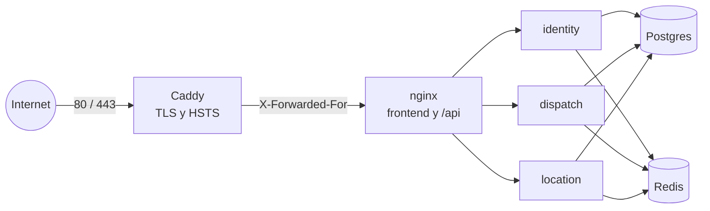

# Despliegue del entorno publicado

El entorno que atacan los otros grupos (ataque cruzado, [ataque.md](ataque.md)). A los grupos se les pasa **una URL**, los usuarios de prueba y la contraseña de esos usuarios. Nada más: ni puertos de servicios, ni `/metrics`, ni la base.

## Qué queda publicado



| | Desarrollo (`docker-compose.yml`) | Publicado (`+ deploy/compose.produccion.yml`) |
|---|---|---|
| Puertos abiertos | 8080 (nginx), 3001, 3004, 3005, 5434, 6379 | **80 y 443 (Caddy)**. Postgres solo en `127.0.0.1` (migraciones y seed desde la máquina) |
| TLS | No | Caddy, con certificado de Let's Encrypt automático, y HSTS |
| Secretos | Los de `.env.example` (`*_dev`, `solo-desarrollo-*`) | Generados al azar en `deploy/.env.produccion` (no se versiona) |
| location | `ingenua` | `optimizada` (aguanta 500 choferes, [mediciones.md](mediciones.md)) |
| Reinicio | No | `restart: unless-stopped`: vuelve solo si se reinicia la máquina |

La IP del cliente llega hasta los servicios en dos saltos: Caddy pone `X-Forwarded-For`, nginx lo cree **solo** si viene de la IP fija de Caddy (`set_real_ip_from ${CADDY_IP}`, por defecto `10.250.77.11`), y los servicios lo creen solo si viene de la IP fija de nginx (`CONFIAR_EN_PROXY`). Así los límites de login por IP cuentan por cliente, y nadie puede inventarse otra IP desde afuera.

`/interno/*`, `/metrics` y `/ready` no se publican (nginx da 404). Los límites de tasa están activos ([seguridad.md](seguridad.md#límite-de-tasa)).

## Requisitos

- Una máquina Linux con Docker y **Compose 2.24 o más nuevo** (`docker compose version`), **Node 22** y Git. Con 2 CPU y 4 GB alcanza para la demo; para correr k6 contra el entorno, más.
- Puertos **80 y 443** abiertos hacia la máquina.
- **Un dominio** con un registro DNS `A` apuntando a la IP de la máquina (Caddy necesita el 80 para sacar el certificado). Sin dominio: `:80` (HTTP) detrás de un túnel que ponga el HTTPS (por ejemplo Cloudflare Tunnel), o detrás de la IP sola si la cátedra lo acepta.

## Levantarlo

Desde el tag congelado, en la máquina publicada:

```bash
git clone <repo> app-viajes && cd app-viajes
git checkout congelado          # o main, antes de congelar
npm ci
node deploy/desplegar.mjs viajes.midominio.com
```

[`deploy/desplegar.mjs`](../deploy/desplegar.mjs) hace todo, y se puede volver a correr las veces que haga falta (no borra datos):

1. Si no existe, arma `deploy/.env.produccion` con secretos nuevos ([`preparar-env.mjs`](../deploy/preparar-env.mjs)): contraseñas de Postgres y de cada base, los tres tokens de servicio, el de métricas, la clave RS256 de identity y la contraseña de los usuarios de prueba. No imprime ninguno. Queda con permisos `600`.
2. Levanta Postgres y Redis.
3. Alinea las contraseñas de los usuarios de cada base con las del archivo (por si el volumen ya existía) e instala PostGIS.
4. Genera el cliente de Prisma y corre las migraciones de las tres bases.
5. Carga los usuarios de prueba (seed de identity).
6. Construye y levanta los tres servicios, nginx y Caddy, y espera a que estén sanos.
7. Arma la demo de flotas y zonas (sin ella, toda solicitud da 422 `ORIGEN_FUERA_DE_ZONA`).

Después, comprobar desde afuera:

```bash
npm run web:probar -- https://viajes.midominio.com deploy/.env.produccion
```

Revisa la CSP, que lo interno no se publica, el 413 en JSON y el SSE sin buffer.

## Qué se les pasa a los grupos atacantes

- La URL: `https://viajes.midominio.com`.
- Los usuarios de prueba (tabla del [README](../README.md#usuarios-de-prueba)) y la contraseña: `IDENTITY_SEED_CONTRASENA` de `deploy/.env.produccion`. Es la única variable de ese archivo que se comparte.
- La referencia de la API: [api.md](api.md).
- Las reglas del ataque ([ataque.md](ataque.md#reglas)): solo este entorno, sin DoS masivo.

## Congelar

Mientras nos atacan, el entorno no se toca. El código que corre es el del tag:

```bash
git tag -a congelado -m "Entorno del ataque cruzado"
git push origin congelado
```

Un hallazgo se corrige en `main`, con su test (ver «Hallazgos recibidos» en [ataque.md](ataque.md)); el entorno congelado se actualiza solo cuando termina el ataque, o si la cátedra lo pide.

## Operación

```bash
C="docker compose -f docker-compose.yml -f deploy/compose.produccion.yml --env-file deploy/.env.produccion"
$C ps                       # estado
$C logs -f dispatch         # una línea JSON por pedido, con requestId
$C restart dispatch         # SIGTERM: drena los pedidos en curso antes de salir (npm run demo:apagado)
$C down                     # bajar todo (los datos quedan en el volumen)
```

Para empezar de cero (borra todos los datos): `$C down -v` y borrar `deploy/.env.produccion`.

Observabilidad (opcional): con las credenciales de Grafana Cloud en `deploy/.env.produccion`, agregar `--profile obs` ([observabilidad.md](observabilidad.md)).

## Coolify

La otra forma de publicarlo: en un servidor con [Coolify](https://coolify.io) (pensado para Coolify 4.7 con Traefik 3.6). Usa [`docker-compose.coolify.yml`](../docker-compose.coolify.yml), un archivo solo, que **no** se suma al `docker-compose.yml`. Lo que hace `desplegar.mjs` desde la máquina, acá lo hacen los contenedores:

| | Con Caddy (`desplegar.mjs`) | Coolify |
|---|---|---|
| TLS | Caddy | El proxy de Coolify (Traefik), con Let's Encrypt |
| Puertos publicados | 80 y 443 (Caddy) | Ninguno: Traefik llega a `web:8080` por la red interna |
| Bases, usuarios y PostGIS | Script de init montado | El mismo script, adentro de la imagen de Postgres ([`infra/postgres/Dockerfile`](../infra/postgres/Dockerfile)) |
| Migraciones | Desde la máquina | Cada servicio, al arrancar (`MIGRAR_AL_ARRANCAR=si`, [`arrancar.sh`](../infra/servicio/arrancar.sh)) |
| Usuarios de prueba | `npm run seed` desde la máquina | El contenedor `semilla`, en cada despliegue (idempotente) |
| IP del cliente | IP fijas de Caddy y nginx | Se confía en `RED_CONFIABLE` (por defecto `10.0.0.0/8`, las redes de Docker en ese servidor) |
| HSTS | Caddy | nginx |

### Primera vez

1. **Secretos**, en tu máquina (no se versionan):
   ```bash
   node deploy/preparar-env.mjs viajes.midominio.com   # deploy/.env.produccion
   node deploy/env-coolify.mjs                         # deploy/.env.coolify: solo lo que usa Coolify
   ```
2. **En Coolify**: *New Resource → Public Repository* (o el repo por la GitHub App), rama `main`, *Build Pack* **Docker Compose**, *Docker Compose Location* `/docker-compose.coolify.yml`.
3. **Environment Variables → Developer view**: pegar el contenido de `deploy/.env.coolify`. Las demás tienen valor por defecto en el compose; se pueden fijar ahí también (tarifas, ofertas, límites).
4. **Domains** del servicio `web`: `https://viajes.midominio.com:8080` (el `:8080` es el puerto del contenedor; no se publica). Los demás servicios, sin dominio.
5. **Deploy**. La primera vez construye las imágenes (unos minutos). Queda listo cuando los 8 contenedores están `healthy`, `semilla` y `alloy` incluidos.
6. **La demo de flotas y zonas**, una vez, desde tu máquina (sin ella, toda solicitud da 422 `ORIGEN_FUERA_DE_ZONA`):
   ```bash
   IDENTITY_SEED_CONTRASENA=<la de deploy/.env.coolify> node scripts/demo-flotas.mjs https://viajes.midominio.com
   ```
7. **Comprobar**:
   ```bash
   npm run web:probar -- https://viajes.midominio.com deploy/.env.produccion
   ```
   Y que la IP del cliente llegue bien: un login con un `X-Forwarded-For` inventado tiene que quedar en el log de identity con tu IP real, no con la inventada:
   ```bash
   curl -s -o /dev/null -H 'X-Forwarded-For: 1.2.3.4' -H 'content-type: application/json' \
     -d '{"email":"nadie@viajes.test","contrasena":"incorrecta-123456"}' https://viajes.midominio.com/api/identity/login
   ```
   Si aparece `1.2.3.4`, o la IP de Traefik para todos, revisar `RED_CONFIABLE` (`docker network inspect` de la red del recurso) y la configuración de `forwardedHeaders` del proxy.

### Cuidados

- **Las contraseñas de las bases se fijan en el primer despliegue** (el init corre con el volumen vacío). Si después se cambian en Coolify, hay que cambiarlas también en Postgres (`ALTER ROLE <servicio>_svc PASSWORD '...'`, desde la terminal del contenedor `postgres` en Coolify), o los servicios no conectan.
- **Backups**: Coolify respalda solo sus bases propias, no un Postgres dentro de un compose. Un *Scheduled Task* sobre `postgres` con `pg_dumpall -U postgres` (o un `pg_dump` por base) a un destino fuera del servidor.
- **Cloudflare**: con el proxy de Cloudflare (nube naranja) delante, la IP que llega a Traefik es la de Cloudflare. Mejor dejar el registro DNS solo (nube gris), o configurar Traefik para que crea el encabezado de Cloudflare.
- **Observabilidad**: el compose trae Alloy, que manda métricas y logs a Grafana Cloud si están las cinco `GRAFANA_CLOUD_*` en las variables del recurso; sin ellas no envía nada ([observabilidad.md](observabilidad.md#en-coolify)). Monta el socket de Docker de solo lectura para leer los logs: es un acceso amplio al daemon, y por eso no publica puertos.
