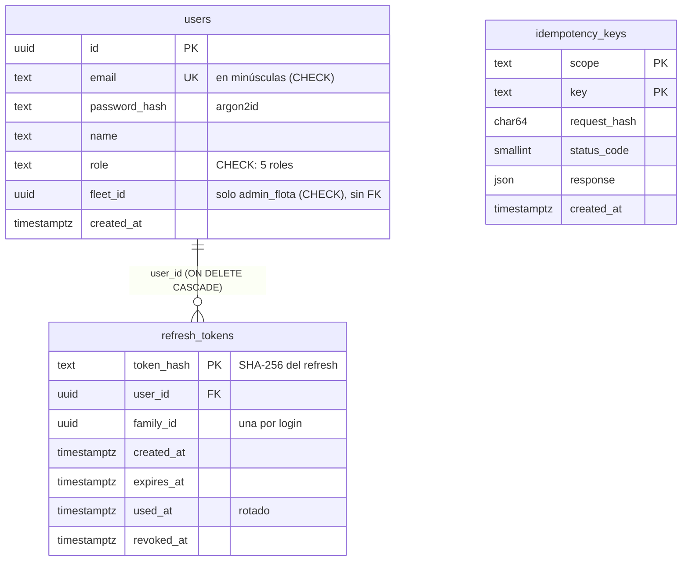
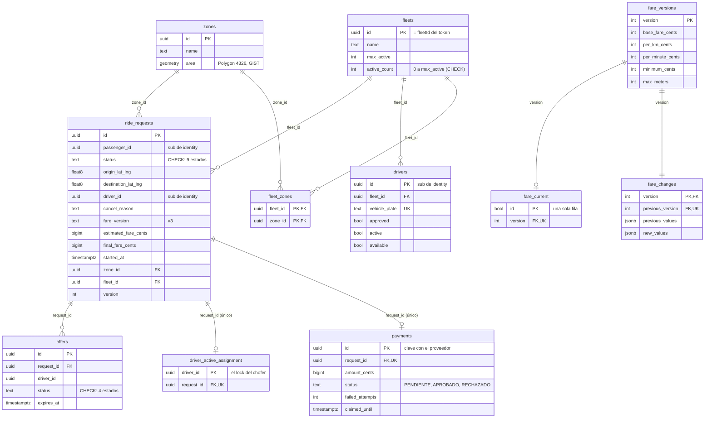
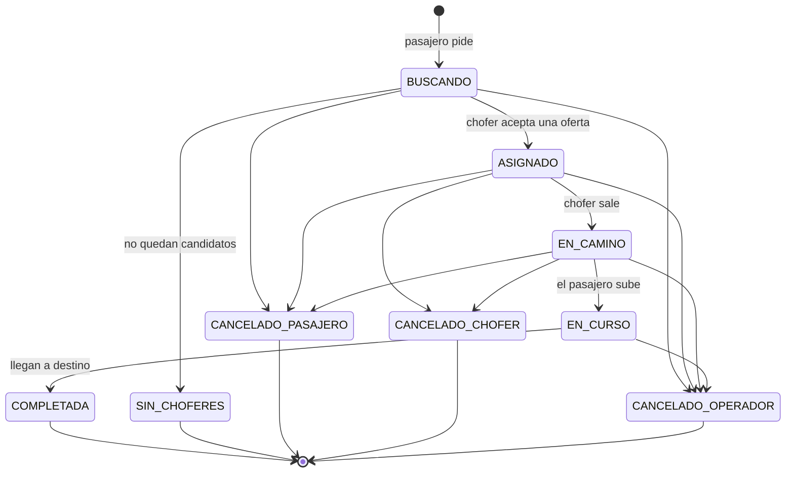
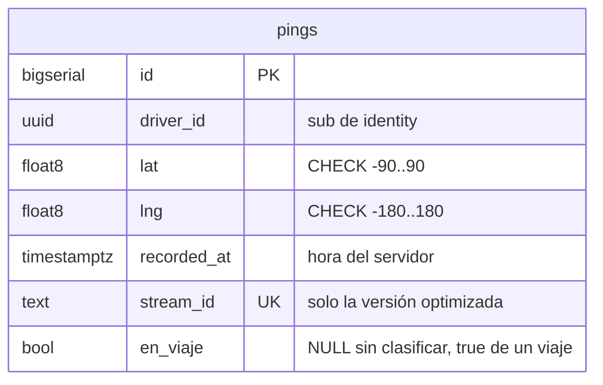

# Modelo de datos

Tres bases de PostgreSQL, una por servicio, y un Redis compartido con un prefijo por servicio. Ningún servicio lee la base de otro: lo que necesita lo pide por HTTP (`/interno/*`, ver [docs/api.md](api.md#rutas-internas-no-publicadas)) o le llega por Redis Pub/Sub.

| Base | Servicio | Tablas |
|---|---|---|
| `identity` | identity | `users`, `refresh_tokens`, `idempotency_keys` |
| `dispatch` | dispatch | viajes (`ride_requests`, `offers`, `driver_active_assignment`, `payments`), tarifas (`fare_versions`, `fare_current`, `fare_changes`), flotas (`fleets`, `drivers`, `zones`, `fleet_zones`), `outbox`, `idempotency_keys` |
| `location` | location | `pings` |

**De dónde sale esto:** los `prisma/schema.prisma` de cada servicio y sus migraciones (`services/*/prisma/migrations`). Prisma no sabe expresar `CHECK`, índices parciales ni columnas PostGIS: todo eso está **solo en el SQL de las migraciones**, agregado a mano. No hay triggers: lo que protege la base está en `CHECK`, índices únicos y claves foráneas.

**Ids entre bases.** El id de un usuario es el `sub` del token que firma identity, y las otras bases lo guardan como UUID **sin clave foránea**, porque la cuenta vive en otra base: `ride_requests.passenger_id`, `drivers.id`, `pings.driver_id`, etc. Lo mismo al revés: `users.fleet_id` apunta a `fleets.id` de dispatch sin FK.

**Estados como texto.** Los estados (`status`) y el rol (`role`) son `text` con un `CHECK`, no enums de Postgres: el SQL crudo de los locks no necesita casts, y la base igual rechaza un valor inventado.

## identity

### `users`

Las cuentas de los cinco roles.

| Restricción | Qué protege |
|---|---|
| `users_email_key` (único) | Un email, una cuenta. Con registros simultáneos del mismo email, decide la base: el segundo recibe 409 `IDENTIFICADOR_EN_USO` |
| `users_email_minusculas_check`: `email = lower(email)` | Sin esto, la unicidad distinguiría mayúsculas. El contrato normaliza el email antes de llegar acá |
| `users_role_check`: `pasajero`, `chofer`, `operador`, `admin`, `admin_flota` | Los mismos roles que acepta `autenticar` en `platform` |
| `users_fleet_id_check`: `(role = 'admin_flota') = (fleet_id IS NOT NULL)` | Un `admin_flota` siempre tiene flota, y ningún otro rol la tiene. De acá sale el claim `fleetId` del token |

El registro público solo crea `pasajero` y `chofer`. Los demás roles salen de la semilla de desarrollo (`infra/db/semilla.ts`). Ver [docs/identity.md](identity.md).

### `refresh_tokens`

Las sesiones. Se guarda **solo el SHA-256** del refresh: con una copia de la base no se renueva ninguna sesión.

- `family_id` agrupa los tokens de un mismo login. Detectar el reuso de un token ya rotado revoca la familia entera. Índices por `family_id` y por `user_id`.
- `refresh_tokens_vigencia_check`: `expires_at > created_at`, y `used_at`, si está, no es anterior a `created_at`.
- La rotación marca el token con `UPDATE … WHERE used_at IS NULL` en la misma transacción que crea el siguiente, y la rotación y la revocación toman antes un `pg_advisory_xact_lock` por familia. El detalle, con sus carreras, en [docs/identity.md](identity.md#post-refresh).

### `idempotency_keys`

La misma tabla en identity y en dispatch: ver [Idempotency-Key](#idempotency-key-idempotency_keys).

## dispatch

Viajes, tarifas, cobros y flotas comparten la base, y por eso pueden compartir transacción: aceptar un viaje revalida al chofer en su flota y en su zona en la misma transacción que lo asigna.

`outbox` e `idempotency_keys` no tienen relaciones: se describen [abajo](#outbox).

### `ride_requests`: la solicitud y el viaje

Una sola fila lleva todo el ciclo de vida del viaje, desde que el pasajero pide hasta que termina. Es **la fila que se bloquea** (`SELECT … FOR UPDATE`) en cada cambio: aceptar, avanzar, cancelar y el barrido de ofertas toman el mismo lock, así que dos cambios sobre el mismo viaje nunca se pisan.

| Columna | Para qué |
|---|---|
| `status` | El estado (ver la [máquina de estados](#la-máquina-de-estados-del-viaje)) |
| `driver_id` | El chofer asignado. Queda guardado también en un viaje terminado o cancelado: el historial del chofer lo lee de acá |
| `cancel_reason` | El motivo de una cancelación. Obligatorio si cancela el operador |
| `fare_version`, `estimated_*` | La estimación con la que se pidió: versión de la tarifa (`v3`), importe, metros y segundos. No cambia nunca después de crear la solicitud |
| `final_*`, `fare_difference_reasons` | La tarifa final, calculada al completar con **la misma versión** que la estimación, y por qué difiere (`DISTANCIA`, `DURACION`). Ver [docs/tarifas.md](tarifas.md#tarifa-final-y-cobro) |
| `started_at` | Cuándo subió el pasajero. De acá se mide la duración real y sale el período del reporte de la flota |
| `zone_id` | La zona del origen, resuelta una vez al crear |
| `fleet_id` | La flota del chofer **al aceptar**: el viaje queda atribuido a esa flota aunque el chofer cambie después |
| `version` | Crece con cada cambio del viaje. Sale en las respuestas para que el cliente sepa cuál de dos lecturas es la más nueva. **No es un lock optimista**: el `UPDATE` no la compara; la exclusión la da el `FOR UPDATE` |
| `created_at` | Lo pone el reloj del dominio al empezar el pedido, antes de buscar choferes: de acá se mide el tiempo hasta la asignación |

**Restricciones:**

| Restricción | Qué protege |
|---|---|
| `ride_requests_status_check` | Solo los 9 estados de la máquina |
| `ride_requests_una_activa_por_pasajero`: índice **único parcial** sobre `passenger_id` `WHERE status IN ('BUSCANDO','ASIGNADO','EN_CAMINO','EN_CURSO')` | **Un pasajero, un viaje activo.** Dos pedidos simultáneos del mismo pasajero: el `INSERT … ON CONFLICT DO NOTHING` del segundo no inserta nada y responde 409 `SOLICITUD_ACTIVA_EXISTENTE`. Lo decide la base, no una lectura previa |
| `ride_requests_con_chofer_check` | `ASIGNADO`, `EN_CAMINO`, `EN_CURSO`, `COMPLETADA` y `CANCELADO_CHOFER` siempre tienen `driver_id`. Los `CANCELADO_PASAJERO` y `CANCELADO_OPERADOR` pueden no tenerlo: se cancela también en `BUSCANDO` |
| `ride_requests_cancelado_operador_con_motivo_check` | `CANCELADO_OPERADOR` siempre con `cancel_reason` (ver [abajo](#cancelado_operador-una-extensión-del-enunciado)) |
| `ride_requests_estimacion_check` | La estimación va completa (versión, importe, metros, segundos ≥ 0) o no va |
| `ride_requests_tarifa_final_check` | La tarifa final va completa o no va, y solo en un viaje con estimación |
| `ride_requests_completada_con_tarifa_check` | En un viaje con estimación: `COMPLETADA` si y solo si tiene tarifa final |
| `ride_requests_motivos_check` | `fare_difference_reasons` solo con `DISTANCIA` y `DURACION` |
| FK `zone_id → zones`, `fleet_id → fleets` (`ON DELETE RESTRICT`) | No se borra una zona ni una flota con viajes |

Las solicitudes de antes de la migración de tarifas tienen toda la tarifa en `NULL`, y las de antes de las zonas, `zone_id` y `fleet_id` en `NULL`. No se completan hacia atrás.

**Índices:**

| Índice | Lo usa |
|---|---|
| `(passenger_id)` | El historial del pasajero |
| `(driver_id)` | El historial del chofer, y los tramos de viaje que pide location para su retención |
| `(status, created_at)` | El panel del operador: filtra por estado y ordena por fecha |
| `(fleet_id, status, started_at)` | El reporte de la flota: sus viajes `COMPLETADA` en un período de inicio |

Los importes son `BIGINT` (migración `20261125000000_importes_bigint_reintentos`): con `INTEGER`, una tarifa que el admin puede configurar pasaba el máximo y la finalización fallaba.

### `offers`

Cada oferta de una solicitud a un chofer, con su vencimiento.

- `status`: `PENDIENTE`, `ACEPTADA`, `VENCIDA` o `CANCELADA` (`offers_status_check`).
- `offers_request_id_driver_id_key` (único): **un chofer recibe como mucho una oferta por solicitud**, aunque el barrido lo vuelva a encontrar.
- `(status, expires_at)`: el barrido busca las pendientes vencidas.
- `expires_at` lo decide el servidor (`OFERTA_TTL_SEGUNDOS`, 15 s). Aceptar compara con la hora del servidor aunque el barrido todavía no haya pasado.

| Transición | La dispara |
|---|---|
| (nueva) → `PENDIENTE` | Crear la solicitud o el barrido, a los más cercanos aptos, de a `OFERTAS_SIMULTANEAS` (3) |
| `PENDIENTE` → `ACEPTADA` | El chofer, con `POST /ofertas/:id/aceptar`, antes de `expires_at` |
| `PENDIENTE` → `VENCIDA` | El barrido (`BARRIDO_INTERVALO_MS`, 2 s), cuando pasa `expires_at` |
| `PENDIENTE` → `CANCELADA` | Otro chofer aceptó la misma solicitud, o la solicitud se canceló. En la misma transacción |

### `driver_active_assignment`: el lock del chofer

Una fila por chofer con un viaje activo. Es la garantía de que **un chofer nunca tiene dos viajes a la vez** ([ADR 0004](adr/0004-asignacion-unica.md)).

- `driver_id` es la **clave primaria**. Aceptar inserta con `ON CONFLICT DO NOTHING`. Si el mismo chofer acepta dos solicitudes distintas a la vez, son dos locks de solicitud distintos y no se esperan: la PK hace esperar a la segunda inserción hasta que la primera confirme, y después no inserta nada. Responde 409 `CHOFER_CON_VIAJE_ACTIVO`.
- `request_id` también es único, con FK a `ride_requests`.
- Se borra en la misma transacción que **completa o cancela** el viaje. Mientras el viaje está `ASIGNADO`, `EN_CAMINO` o `EN_CURSO`, la fila existe.
- El filtro de candidatos excluye a los choferes que tienen fila acá ([docs/flotas.md](flotas.md#el-filtro-de-candidatos)).

**Asignación única, de punta a punta:** `FOR UPDATE` de la solicitud (dos aceptaciones de la misma solicitud van de a una, y la segunda ve `ASIGNADO`: 409 `SOLICITUD_NO_DISPONIBLE`) → revalidación del chofer con `FOR SHARE` → reserva en `driver_active_assignment`. Siempre en ese orden.

### `payments`

Un cobro por viaje completado, por la tarifa final. Lo crea la finalización, en su misma transacción, como `PENDIENTE`. Ver [docs/tarifas.md](tarifas.md#tarifa-final-y-cobro).

| Restricción | Qué protege |
|---|---|
| `payments_request_id_key` (único) | **Un cobro por viaje**: una segunda finalización no puede crear otro |
| `id` (PK) | También es la clave de idempotencia con el proveedor de pagos: reintentar con la misma nunca cobra dos veces |
| `payments_status_check` | `PENDIENTE`, `APROBADO` o `RECHAZADO` |
| `payments_resuelto_check` | `PENDIENTE` sin referencia ni motivo; `APROBADO` con la referencia del proveedor; `RECHAZADO` con referencia y motivo |
| `payments_amount_check`, `payments_currency_check`, `payments_failed_attempts_check` | Importe ≥ 0, moneda `ARS`, intentos ≥ 0 |

- `PENDIENTE → APROBADO | RECHAZADO`, y los dos últimos son finales. Un proveedor caído o que no contesta **deja el cobro `PENDIENTE`** (falla cerrado), suma `failed_attempts` y anota `last_error`.
- El resultado se registra con el cobro bloqueado (`FOR UPDATE`) y solo si sigue `PENDIENTE`.
- Índice `(status, updated_at)`: el barrido toma los pendientes que hace más que no se intentan. Cada fallo toca `updated_at` y manda el cobro al final de la cola, así unos pocos que fallan siempre no frenan a los demás.
- `claimed_until` (migración `20261129000000_cobros_reclamo`): el barrido **reclama** los que elige con `FOR UPDATE SKIP LOCKED` y les pone un vencimiento (120 s). Con varias instancias, dos barridos no eligen el mismo cobro. Un fallo suelta el reclamo; si la instancia muere, vence solo.

### Tarifas: `fare_versions`, `fare_current`, `fare_changes`

Tarifa global versionada. Detalle en [docs/tarifas.md](tarifas.md#configuración-por-el-admin).

| Tabla | Qué guarda | Restricciones |
|---|---|---|
| `fare_versions` | Una fila por versión. **No se modifica nunca**: cada cambio crea una nueva | `version ≥ 1`, moneda `ARS`, importes entre 0 y 100 000 000 centavos, `max_meters` entre 1 y 1 000 000 |
| `fare_current` | La versión vigente | Una sola fila: PK `id boolean` con `CHECK (id)`. Las ediciones la bloquean y así se serializan |
| `fare_changes` | La auditoría: quién, cuándo, valores anteriores y nuevos, y el `requestId` del pedido | `fare_changes_cadena_check`: la versión 1 sin anterior; cada otra, con `previous_version = version - 1` y sus valores anteriores. `previous_version` único: una versión tiene como mucho un cambio que la sigue |

El `CHECK` de la cadena se corrigió en una migración aparte (`20261122120000_tarifas_auditoria_check`): el original aceptaba una versión 5 sin anterior, porque un `CHECK` que da `NULL` se considera cumplido.

`ride_requests.fare_version` guarda la versión como texto (`v3`) y **no tiene FK** a `fare_versions`.

### Flotas y zonas: `fleets`, `drivers`, `zones`, `fleet_zones`

Variante G. El detalle, con la carrera del cupo y los locks, está en [docs/flotas.md](flotas.md#modelo). Lo que hace la base:

| Tabla | Restricción | Qué protege |
|---|---|---|
| `fleets` | `fleets_cupo_check`: `active_count >= 0 AND active_count <= max_active` | **El límite de activos por flota.** Activar ocupa un cupo con `UPDATE fleets SET active_count = active_count + 1 WHERE id = $1 AND active_count < max_active`: comparar y sumar en una sola sentencia. Con 0 filas, la flota está llena (409 `LIMITE_FLOTA_ALCANZADO`). El `CHECK` es la red de seguridad si algún camino saltea esa condición |
| `fleets` | `max_active` entre 0 y 10 000; `name` de 1 a 80 caracteres | |
| `drivers` | PK `id` (el `sub` del chofer) | Un chofer está en una sola flota |
| `drivers` | `drivers_activo_habilitado_check`: `NOT active OR approved` | No se está activo sin habilitación |
| `drivers` | `drivers_disponible_activo_check`: `NOT available OR active` | No se está disponible sin estar activo |
| `drivers` | `vehicle_plate` único y con formato `ABC123` o `AB123CD` | Una patente, un vehículo |
| `zones` | `area geometry(Polygon, 4326)`, índice GIST, `CHECK (ST_IsValid(area))` | Polígonos válidos. Que dos zonas no se superpongan **no** lo puede decir un `CHECK` (mira otras filas): lo controla el repositorio con un `pg_advisory_xact_lock` |
| `fleet_zones` | PK `(fleet_id, zone_id)`, índice por `zone_id` | En qué zonas opera cada flota. La aceptación toma `FOR SHARE` de esta fila: quitarle la zona a la flota (un `DELETE`) espera |

`ride_requests.driver_id`, `offers.driver_id` y `driver_active_assignment.driver_id` no tienen FK hacia `drivers`: los tres guardan el `sub` del chofer, igual que `drivers.id`, pero la relación no la impone la base.

PostGIS se instala con `CREATE EXTENSION IF NOT EXISTS postgis` en la migración `20261127000000_zonas`. En desarrollo la crea el init de Postgres, porque `dispatch_svc` no es superusuario ([docs/flotas.md](flotas.md#zonas-operativas-pr-2)).

### `outbox`

Los eventos de dispatch, escritos **en la misma transacción** que el cambio que los produce. Un relay los publica en Redis Pub/Sub y el stream SSE los entrega. Ver [docs/eventos.md](eventos.md).

| Columna | Para qué |
|---|---|
| `id` | PK (UUID) |
| `type`, `payload` | El evento (`TripAssigned`, …) y su payload (`jsonb`), con el contrato de `packages/contracts/src/dispatch.ts` |
| `seq` | `BIGSERIAL`, único. Es el `id:` del evento en el stream SSE y lo que el cliente manda en `Last-Event-ID` |
| `recipients` | `uuid[]`: el pasajero y el chofer del payload. Nadie más recibe el evento |
| `request_id` | El `requestId` del pedido HTTP que lo produjo, para cruzarlo con el log. **No** es el id de la solicitud de viaje |
| `published_at` | `NULL` hasta que el relay lo publica |

| Índice | Lo usa |
|---|---|
| `outbox_pendientes_idx`: `(seq) WHERE published_at IS NULL` (parcial) | El relay: los que faltan publicar, en orden, con `FOR UPDATE SKIP LOCKED` (varias instancias toman filas distintas) |
| `outbox_recipients_idx`: GIN sobre `recipients` | La reposición al reconectar: los eventos de un usuario con `seq` mayor que el `Last-Event-ID` |
| `outbox_seq_key` (único) | Un `seq` por evento |
| `(published_at, created_at)` | De la migración inicial, de antes del `seq`. El relay actual ordena por `seq` y usa el índice parcial |

El outbox **se conserva** `OUTBOX_RETENCION_HORAS` (24 h): la reposición del SSE lee de acá. Después, una purga borra por lotes los eventos ya publicados (nunca uno pendiente), con `FOR UPDATE SKIP LOCKED` (`purgarOutboxPrisma`).

### Idempotency-Key: `idempotency_keys`

La misma tabla en identity y en dispatch ([ADR 0010](adr/0010-idempotencia.md)). Una fila por clave ya resuelta:

| Columna | Para qué |
|---|---|
| `scope` + `key` | PK. `scope` es de quién es la clave: el usuario del token; `<usuario>:flota:<fleetId>` en las escrituras de `/flota/*`; `registro:<SHA-256 del email>` en el registro de identity |
| `request_hash` | SHA-256 del método, la ruta y el cuerpo validado. La misma clave con otro pedido: 422 `CLAVE_IDEMPOTENCIA_REUTILIZADA`. En el registro, la contraseña no entra |
| `status_code`, `response` | La respuesta, para repetirla tal cual. `json` y no `jsonb`: se devuelve con las claves en el mismo orden |
| `created_at` | Índice para la purga |

- **Se inserta en la misma transacción que el efecto**, con `ON CONFLICT DO NOTHING RETURNING`. Si la clave ya estaba, otro pedido con la misma clave confirmó primero: esta transacción se deshace (409 `CLAVE_IDEMPOTENCIA_EN_CURSO`) y el efecto no se repite. Así nunca queda efecto sin registro ni registro sin efecto.
- El cerrojo en Redis frena a los duplicados simultáneos antes de llegar al caso de uso; la PK de esta tabla es la garantía si el cerrojo vence con el pedido en curso.
- Solo se guarda lo que salió bien: un error no tuvo efecto, y el reintento se procesa de nuevo.
- **Purga:** cada `IDEMPOTENCIA_PURGA_INTERVALO_MS` (60 s) se borran, en lotes y con `FOR UPDATE SKIP LOCKED`, los registros más viejos que `IDEMPOTENCIA_RETENCION_HORAS` (24 h).

## La máquina de estados del viaje

Vive en la entidad `SolicitudViaje` (`services/dispatch/src/dominio/entidades/solicitud-viaje.ts`). Cualquier transición que no está acá lanza un error de dominio y no cambia nada. La base la respalda con los `CHECK` de [`ride_requests`](#ride_requests-la-solicitud-y-el-viaje).

| Estado | Enunciado | Activo | Con chofer reservado |
|---|---|---|---|
| `BUSCANDO` | solicitado | sí | no |
| `ASIGNADO` | asignado | sí | sí |
| `EN_CAMINO` | chofer en camino | sí | sí |
| `EN_CURSO` | en curso | sí | sí |
| `COMPLETADA` | finalizado | no | no (se libera al completar) |
| `CANCELADO_PASAJERO` | cancelado por pasajero | no | no |
| `CANCELADO_CHOFER` | cancelado por chofer | no | no |
| `CANCELADO_OPERADOR` | (extensión) | no | no |
| `SIN_CHOFERES` | sin choferes disponibles | no | no |

«Activo» es lo que cuenta el índice único del pasajero: mientras su viaje está activo, no puede pedir otro.

**Quién dispara cada transición:**

| Transición | Quién | Ruta | Error si no corresponde |
|---|---|---|---|
| → `BUSCANDO` | pasajero | `POST /solicitudes` | 409 `SOLICITUD_ACTIVA_EXISTENTE` si ya tiene uno activo |
| `BUSCANDO → SIN_CHOFERES` | el sistema: al crear, si no hay aptos (la respuesta ya trae `SIN_CHOFERES`), o el barrido, cuando vencen todas las ofertas y no queda a quién ofrecer | — | — |
| `BUSCANDO → ASIGNADO` | chofer con una oferta vigente | `POST /ofertas/:id/aceptar` | 409 `SOLICITUD_NO_DISPONIBLE`, `OFERTA_VENCIDA`, `CHOFER_NO_APTO` o `CHOFER_CON_VIAJE_ACTIVO` |
| `ASIGNADO → EN_CAMINO` | el chofer asignado | `POST /solicitudes/:id/en-camino` | 409 `TRANSICION_INVALIDA` |
| `EN_CAMINO → EN_CURSO` | el chofer asignado. Guarda `started_at` | `POST /solicitudes/:id/iniciar` | 409 `TRANSICION_INVALIDA` |
| `EN_CURSO → COMPLETADA` | el chofer asignado. En la misma transacción: tarifa final, libera al chofer y crea el cobro `PENDIENTE` | `POST /solicitudes/:id/finalizar` | 409 `TRANSICION_INVALIDA` |
| → `CANCELADO_PASAJERO` | el pasajero, desde `BUSCANDO`, `ASIGNADO` o `EN_CAMINO` (ya arriba del auto, no) | `POST /solicitudes/:id/cancelar` | 409 `SOLICITUD_NO_CANCELABLE` |
| → `CANCELADO_CHOFER` | el chofer asignado, desde `ASIGNADO` o `EN_CAMINO` | `POST /solicitudes/:id/cancelar` | 409 `SOLICITUD_NO_CANCELABLE` |
| → `CANCELADO_OPERADOR` | `operador` o `admin`, desde cualquier estado activo, **con motivo** | `POST /solicitudes/:id/cancelar` | 409 `SOLICITUD_NO_CANCELABLE`; 422 `MOTIVO_REQUERIDO` sin motivo |

- Cancelar desde un estado con chofer lo libera (borra su fila de `driver_active_assignment`) y cancela las ofertas pendientes, en la misma transacción.
- Un viaje ajeno responde 404 `SOLICITUD_NO_ENCONTRADA`, igual que uno inexistente: el chofer solo avanza o cancela el suyo, y el pasajero solo cancela el suyo.
- Cada transición escribe su evento en el `outbox` en la misma transacción ([catálogo](eventos.md#catálogo)).

### `CANCELADO_OPERADOR`: una extensión del enunciado

El enunciado tiene dos cancelaciones: por el pasajero y por el chofer. Agregamos una tercera: **la del operador** (y la del `admin`, que cancela como operador). Se hace desde el panel del operador ([docs/web.md](web.md#el-panel-del-operador-operador)).

- Es un estado propio, no un `CANCELADO_PASAJERO` con otra marca: en el historial y en el panel se distingue quién canceló.
- Puede cancelar en **cualquier estado activo**, también `EN_CURSO`, que ni el pasajero ni el chofer pueden cancelar.
- **El motivo es obligatorio**, en tres capas:
  - el contrato (`CancelarBody`): si viene, entre 3 y 200 caracteres;
  - el dominio: sin motivo, 422 `MOTIVO_REQUERIDO` (para pasajero y chofer es opcional);
  - la base: `ride_requests_cancelado_operador_con_motivo_check` rechaza un `CANCELADO_OPERADOR` con `cancel_reason` `NULL`, aunque un error de programación se saltee el dominio.
- El evento `RideCancelled` lleva `canceladoPor: "operador"` y el `motivo`.

## location

### `pings`

El historial de posiciones de los choferes. Las dos versiones de 6.6 escriben acá: la **ingenua** inserta un ping por pedido y busca candidatos sobre esta tabla; la **optimizada** busca en Redis y escribe el historial en lotes desde un stream ([docs/location.md](location.md)).

| Columna o índice | Para qué |
|---|---|
| `recorded_at` | La hora **del servidor**, no la del celular: nadie puede «rejuvenecer» una posición |
| `pings_lat_check`, `pings_lng_check` | Coordenadas posibles, por si algún camino no valida |
| `(driver_id, recorded_at DESC)` | La búsqueda ingenua: la última posición de cada chofer (`DISTINCT ON`) |
| `stream_id` (único) | El id de la entrada del stream de Redis. Reescribir un lote después de una caída no duplica filas. `NULL` en las de la ingenua |
| `(recorded_at, id)` | La purga de la retención: borra los vencidos en lotes, por este orden |
| `pings_sin_clasificar_idx`: `(recorded_at, id) WHERE en_viaje IS NULL` (parcial) | La clasificación por viaje: solo los que faltan clasificar. Prisma no expresa el `WHERE`: está solo en la migración |

**Retención** ([docs/location.md](location.md#retención-del-historial)): los pings de un viaje se conservan 30 días (`en_viaje = true`) y los demás, 24 h. Para saber cuáles fueron de un viaje, location le pregunta a dispatch por `POST /interno/tramos-viaje`.

## Qué vive en Redis y qué en Postgres

**Postgres es la fuente de verdad** de todo lo que no se puede perder: cuentas, sesiones, viajes, ofertas, cobros, tarifas, flotas, eventos y el historial de posiciones. **Redis** guarda lo efímero o lo derivado: contadores, cerrojos, cachés, la posición vigente de cada chofer y los canales de Pub/Sub. Si se pierde Redis, no se pierde ningún viaje.

| Clave o canal | Tipo | TTL | Servicio | Para qué |
|---|---|---|---|---|
| `identity:login:email:<SHA-256 del email>` | contador | `IDENTITY_LOGIN_VENTANA_SEGUNDOS` (900 s) | identity | Intentos de login por email. Un login correcto lo borra |
| `identity:login:ip:<ip>` | contador | 900 s | identity | Intentos de login por IP |
| `identity:idempotencia:<scope>:<clave>` | string | `IDEMPOTENCIA_EN_VUELO_SEGUNDOS` (30 s) | identity | Cerrojo de la `Idempotency-Key` mientras el pedido está en vuelo. Se suelta al responder |
| `dispatch:idempotencia:<scope>:<clave>` | string | 30 s | dispatch | Lo mismo, en dispatch |
| `dispatch:tarifas:v<N>` | string (JSON) | `TARIFAS_CACHE_TTL_SEGUNDOS` (3600 s) | dispatch | Caché de los parámetros de cada versión de tarifa. Qué versión está vigente se lee siempre de Postgres |
| `dispatch:zonas:generacion` y `dispatch:zonas:mapa:<generacion>` | string y string (JSON) | — y `ZONAS_CACHE_TTL_SEGUNDOS` (60 s) | dispatch | Caché de las zonas (polígonos y flotas de cada una), por generación: editar zonas pone una nueva. La aceptación no lo usa ([flotas.md](flotas.md#el-caché-de-zonas-redis)) |
| `dispatch:tasa:solicitudes:<usuarioId>` | contador | la ventana (60 s) | dispatch | Límite de tasa de `POST /solicitudes` |
| `dispatch:eventos:<usuarioId>` | canal Pub/Sub | — | dispatch | Los eventos del outbox, uno por destinatario. No guarda nada: lo perdido se repone del `outbox` |
| `location:pos` | HASH | — | location (optimizada) | Última posición de cada chofer, con las coordenadas originales |
| `location:geo` | GEO | — | location (optimizada) | Índice para buscar candidatos en un radio |
| `location:visto` | ZSET | — | location (optimizada) | Hora de la última posición de cada chofer: vencimiento y purga |
| `location:fuera-geo` | SET | — | location (optimizada) | Choferes con latitud que Redis GEO no acepta |
| `location:historial` | STREAM | — (tope `LOCATION_HISTORIAL_MAX`) | location (optimizada) | Pings pendientes de escribir en `pings` |
| `location:historial:descartados` | contador | — | location (optimizada) | Pings que no entraron por cola llena |
| `location:publicada:<choferId>`, `location:publicada-pasajero:<pasajeroId>` | string | 2 × `UBICACION_VIGENCIA_SEGUNDOS` (60 s) | location | Hora de la última posición publicada: no se anuncia una más vieja después de una nueva |
| `location:tasa:ubicaciones:<usuarioId>` | contador | 60 s | location (optimizada) | Límite de tasa de `POST /ubicaciones` y `POST /ubicaciones/pasajero` |
| `location:posicion:<choferId>`, `location:posicion-pasajero:<pasajeroId>` | canales Pub/Sub | — | location publica, dispatch se suscribe | La posición en vivo ([docs/eventos.md](eventos.md#posición-en-vivo)) |

- El prefijo de location es `LOCATION_REDIS_PREFIJO` (`location:` por defecto; `carga:location:` en el entorno de k6).
- **Con la estrategia ingenua** (la del Compose), location no guarda posiciones en Redis, y el contador del límite de tasa queda **en memoria del proceso**. Con `REDIS_URL`, igual publica la posición en vivo.
- El límite de 3 streams SSE por usuario se cuenta en cada proceso y, entre instancias, en `dispatch:sse:<usuarioId>` (ZSET: un miembro por stream, con su vencimiento; lo renueva el latido, y si el lugar se perdió lo vuelve a tomar dentro del límite o cierra el stream).
